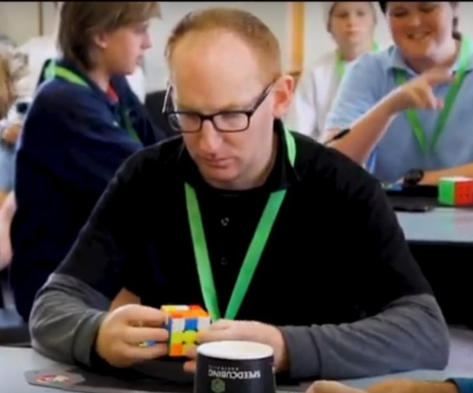

<link rel="stylesheet" type="text/css" href="../../css/flags.css" />

## [Senior Cubers Worldwide - Weekly Comp Results](../../results/)
### [Anthony Rochester](README.md) - [2019ROCH03](https://www.worldcubeassociation.org/persons/2019ROCH03?event=fto)

<i class="flag flag-AU" />&nbsp;Australia

#### Face Turning Octahedron Results

🥇 = 1st senior, 🥈 = 2nd senior, 🥉 = 3rd senior, 🔥 = PR average, ⚡ = PR single.

| Date | Age | Single | Average | Awards | Solve 1 | Solve 2 | Solve 3 | Solve 4 | Solve 5 | Video |
| :--: | :--: | --: | --: | :--: | --: | --: | --: | --: | --: | :-- |
| [2026-10-26](../../results/2026-10-26/fto.md) | 40+ | **55.90** | **59.75** | 🥈 🔥 ⚡ | 57.91 | 57.15 | **55.90** | 1:07.29 | 1:04.20 | [Desktop](https://www.facebook.com/events/1160708429620175/permalink/1171757685181916) / [Mobile](https://m.facebook.com/events/1160708429620175?view=permalink&id=1171757685181916) |

<!-- Global site tag (gtag.js) - Google Analytics -->

