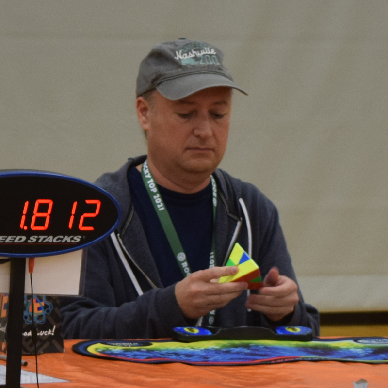

<link rel="stylesheet" type="text/css" href="../../css/flags.css" />

## [Senior Cubers Worldwide - Weekly Comp Results](../../results/)
### [Eric Dodson](README.md) - [2021DODS01](https://www.worldcubeassociation.org/persons/2021DODS01?event=fto)

<i class="flag flag-US" />&nbsp;United States

#### Face Turning Octahedron Results

🔥 = PR average, ⚡ = PR single.

| Date | Age | Single | Average | Awards | Solve 1 | Solve 2 | Solve 3 | Solve 4 | Solve 5 | Video |
| :--: | :--: | --: | --: | :--: | --: | --: | --: | --: | --: | :-- |
| [2026-11-09](../../results/2026-11-09/fto.md) | 50+ | **1:15.57** | **1:27.46** | 🔥 ⚡ | 1:58.78 | 1:27.90 | 1:38.44 | **1:15.57** | 1:16.03 | [Desktop](https://www.facebook.com/events/2340548276798834/permalink/2350519749135020) / [Mobile](https://m.facebook.com/events/2340548276798834?view=permalink&id=2350519749135020) |

<!-- Global site tag (gtag.js) - Google Analytics -->

